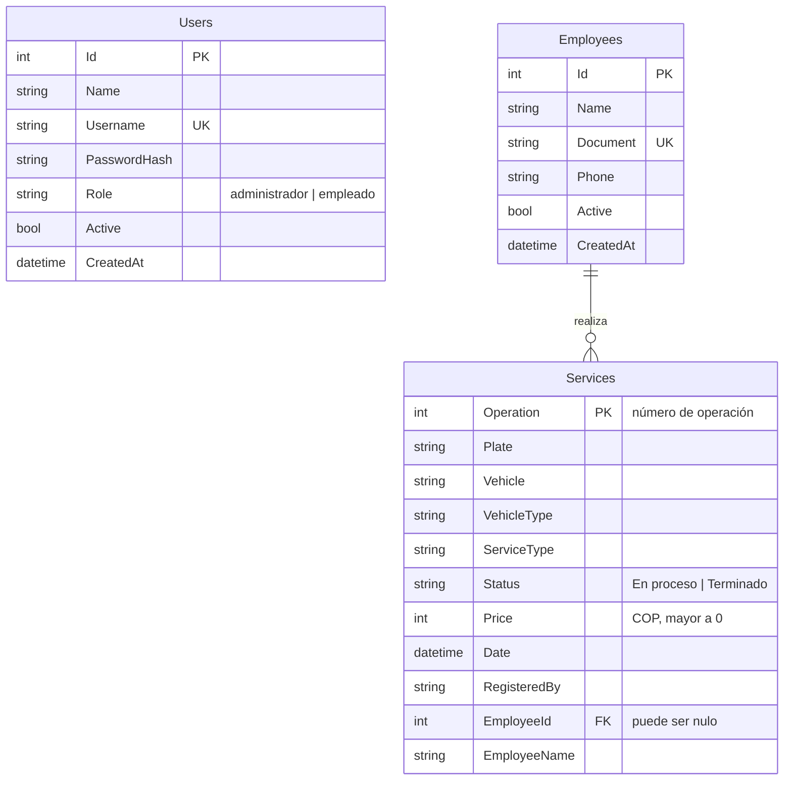

# Base de datos de AlingBalance

Tres tablas guardan todo: **usuarios**, **empleados** y **servicios**. La API
(`backend/`) es la única que las lee y escribe; la app Flutter nunca toca la
base de datos directamente.

## ¿Qué archivo uso?

| Quiero…                                     | Uso                                                   |
|---------------------------------------------|-------------------------------------------------------|
| Arrancar ya, sin instalar nada              | **`backend/AlingBalance.Api/alingbalance.db`** (SQLite, ya viene lista con el administrador) |
| Crear la base en SQLite desde cero          | `sqlite/schema.sql` (y opcionalmente `sqlite/demo_data.sql`) |
| Usar SQL Server                             | `sqlserver/01_schema.sql` (y opcionalmente `02_demo_data.sql`) |
| Ver o probar consultas                      | `queries.sql`                                         |

> Si no haces nada, el servidor crea la base solo la primera vez que arranca
> (con el mismo esquema). Estos archivos sirven para tenerla lista, revisarla o
> usar SQL Server.

**Usuario inicial:** `admin` · **contraseña:** `admin123` (cámbiala). Los datos
de ejemplo agregan además `maria` / `clave123` (rol empleado).

## Diagrama



`Users` no tiene llave foránea: `Services.RegisteredBy` guarda el **nombre** de
quien registró el servicio, y `Services.EmployeeName` el nombre del empleado al
momento de registrarlo (así el historial no cambia si luego editan el nombre).

## Tablas y restricciones

| Tabla       | Campo clave / único        | Reglas que protege la base de datos                          |
|-------------|----------------------------|--------------------------------------------------------------|
| `Users`     | `Username` único           | `Role` solo `administrador` o `empleado`                      |
| `Employees` | `Document` único           | —                                                            |
| `Services`  | `Operation` (autonumérico) | `Price > 0` · `Status` solo `En proceso` o `Terminado` · `EmployeeId` debe existir en `Employees`; si se borra el empleado, el servicio se conserva sin asignar |

Las demás validaciones (formato de placa, teléfono, contraseña, precio máximo,
servicios repetidos, etc.) las aplica la API; ver `backend/README.md`.

La contraseña **nunca** se guarda: `PasswordHash` tiene el formato
`iteraciones.sal.hash` (PBKDF2-SHA256), igual que genera la API.

## Cómo usarla

### SQLite (la más simple)

El servidor usa `Data Source=alingbalance.db` (en `appsettings.json`), que es el
archivo de `backend/AlingBalance.Api/`. Solo ejecuta `dotnet run` ahí.

Para crearla desde cero o cargar los datos de ejemplo:

```bash
sqlite3 alingbalance.db < database/sqlite/schema.sql
sqlite3 alingbalance.db < database/sqlite/demo_data.sql   # opcional
```

Para mirarla con interfaz: [DB Browser for SQLite](https://sqlitebrowser.org/)
(abre el archivo `.db`).

### SQL Server

1. Ejecuta `sqlserver/01_schema.sql` (crea la base `AlingBalance`, las tablas y
   el administrador) y, si quieres, `02_demo_data.sql`, en SQL Server Management
   Studio o Azure Data Studio.
2. En `backend/AlingBalance.Api/appsettings.json`:

```json
"Database": { "Provider": "SqlServer" },
"ConnectionStrings": {
  "Default": "Server=localhost;Database=AlingBalance;Trusted_Connection=True;TrustServerCertificate=True"
}
```

## Copias de seguridad

- **SQLite:** con el servidor apagado, copia el archivo `alingbalance.db`.
- **SQL Server:** `BACKUP DATABASE AlingBalance TO DISK = 'C:\respaldo\AlingBalance.bak';`

Haz copias seguido: la base es la única fuente de datos del sistema.

## Cambios futuros

Hoy el esquema lo crea `EnsureCreated`, que no actualiza una base ya existente.
Cuando agregues campos o tablas con datos reales, usa migraciones de Entity
Framework Core (`dotnet ef migrations add`, `dotnet ef database update`).
